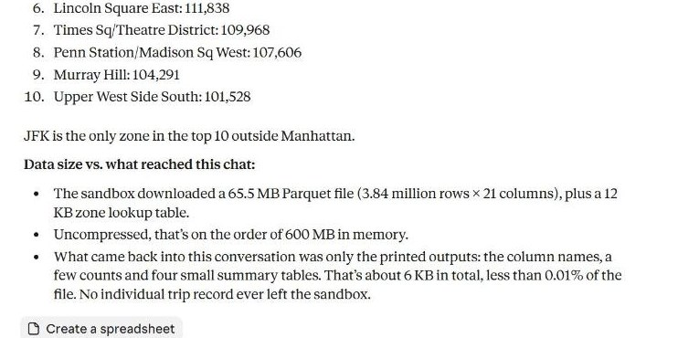

# Analyse a dataset too big for a chat

3.8 million NYC yellow-taxi trips from June 2026 – a 65 MB Parquet file, about 437 MB as CSV. Far too much to paste into a conversation with an AI assistant.

The sandbox downloads the file itself, computes there and returns only a summary of a few kilobytes: trips per hour, average tip by payment type and the top pickup zones.



## Try it in Claude or ChatGPT

With WBX Sandbox connected ([setup](../../README.md#connect-your-assistant-in-a-minute)):

> Analyze the NYC yellow taxi trips for June 2026: https://d37ci6vzurychx.cloudfront.net/trip-data/yellow_tripdata_2026-06.parquet Don't paste the data into this chat. Download it into a WBX sandbox and work there. I want the number of trips, the busiest hours, average fare and tip by payment type, and the top 10 pickup zones. At the end, tell me how big the data was and how much of it actually came back into our conversation.

In our recorded run the sandbox processed 65.5 MB and about 6 KB of output came back into the chat (Claude's own count).

## Run it with the SDK

```bash
python analyze.py                      # June 2026
python analyze.py <other-parquet-url>  # any month from the TLC trip record data
```

The sandbox may only reach the data host and PyPI (`allow=[...]`). The analysis uses pyarrow and reads one row group at a time, so the `base` template (512 MB RAM) is enough.

Data: [NYC Taxi & Limousine Commission – TLC Trip Record Data](https://www.nyc.gov/site/tlc/about/tlc-trip-record-data.page).
