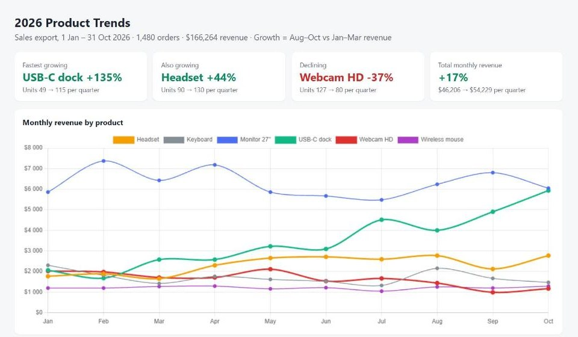
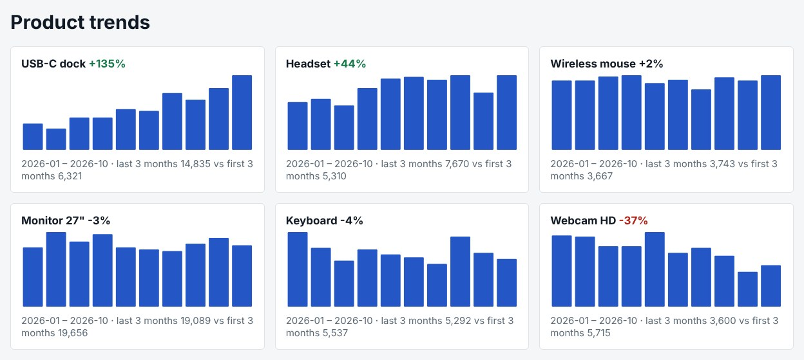

# Spreadsheet → shareable dashboard

Upload a sales export, let the sandbox work out which products are growing or declining, and get a dashboard behind an HTTPS link you can send to your team.



## Try it in Claude or ChatGPT

Attach [sales-2026.csv](sales-2026.csv) (demo data) and ask:

> Here's our sales export for this year. Which products are growing and which are declining? Use WBX Sandbox to analyze it in Python, then make a small dashboard with a few charts and give me a link I can share with the team.

Tip: when a file goes through the chat, the assistant has to copy it into the sandbox itself, which takes a while for larger files. For big data, give the assistant a URL instead – see [big-dataset](../big-dataset/).

## Run it with the SDK

```bash
python dashboard.py                 # uses the bundled demo data
python dashboard.py your-export.csv # columns: date, product, quantity, unit_price
```

What `dashboard.py` builds from the demo data:



The sandbox has no network access (`internet=False`); the dashboard is a single self-contained page served from the sandbox. The link carries an access token – anyone with the full link can open it until the sandbox ends.
