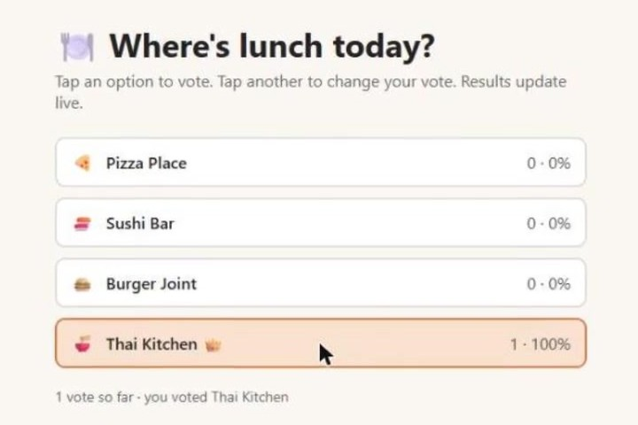

# Run a web app and share it over HTTPS

Any port in a sandbox can get a public HTTPS address protected by a token. This example runs a tiny team lunch poll (standard-library Python, no dependencies) and prints the link to share.



## Try it in Claude or ChatGPT

> Make a simple web page where my team can vote on where to go for lunch today: Pizza Place, Sushi Bar, Burger Joint or Thai Kitchen. Show live results, run it in a WBX sandbox and give me a link I can share.

## Run it with the SDK

```bash
python poll.py
python poll.py "Pizza,Sushi,Salad"
```

How it works: the app listens on `0.0.0.0:8000` inside the sandbox, and `sb.get_url(8000)` returns `url_with_token`. Opening that link moves the token into a cookie; scripts can send the `X-WBX-Token` header instead. The sandbox has no outbound network access. When the sandbox ends, the app and its data are gone.
